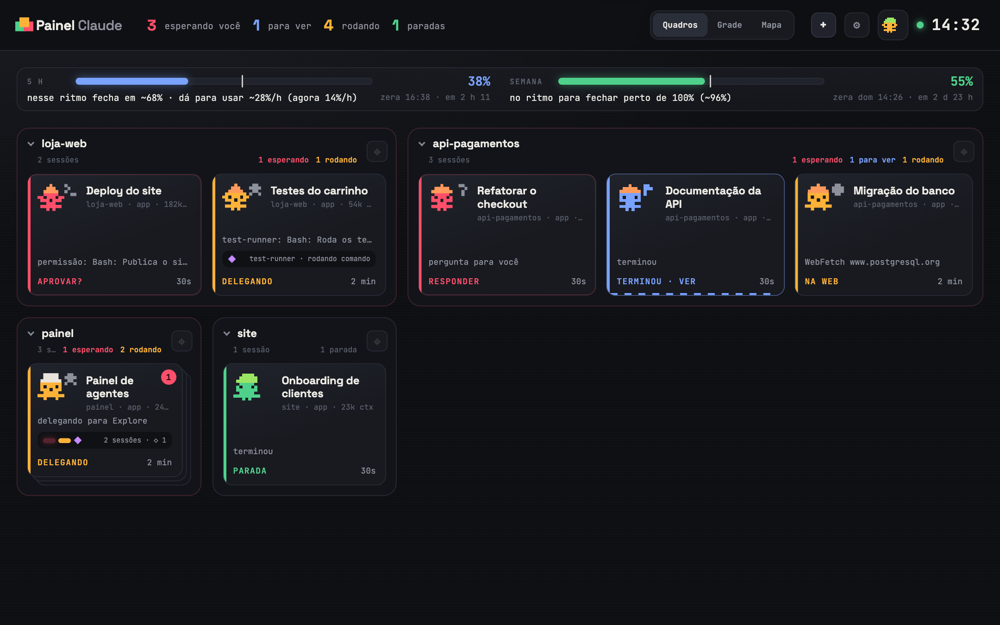
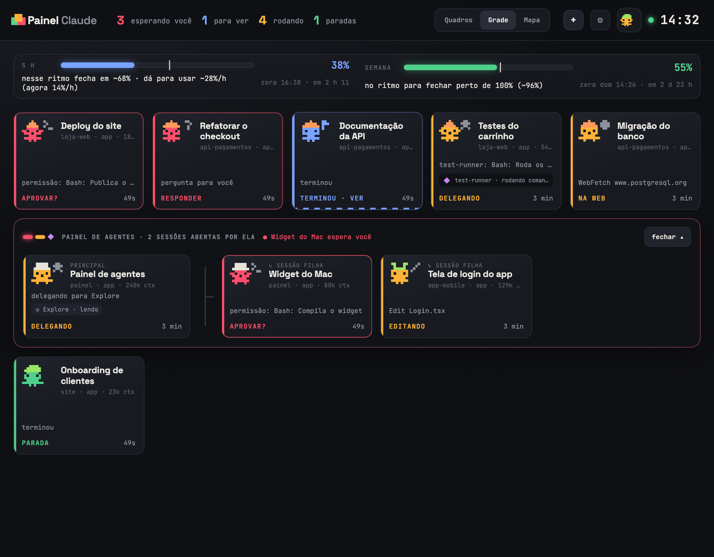
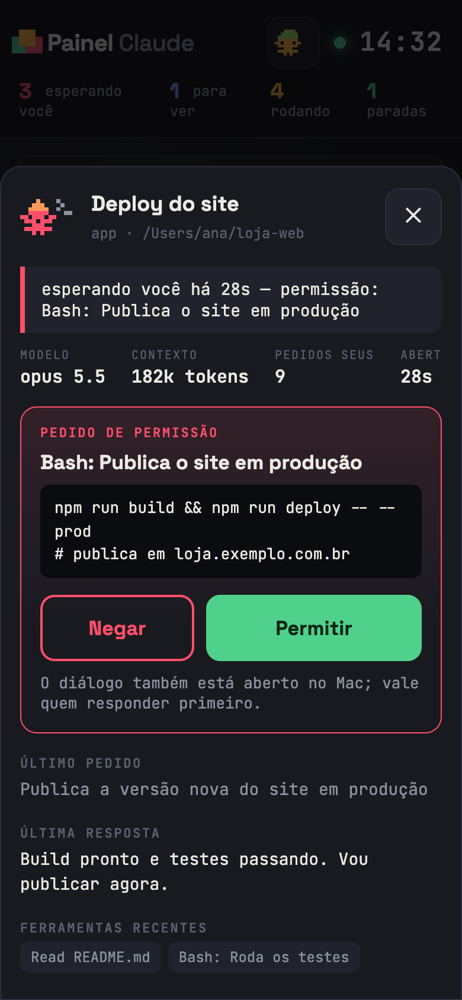
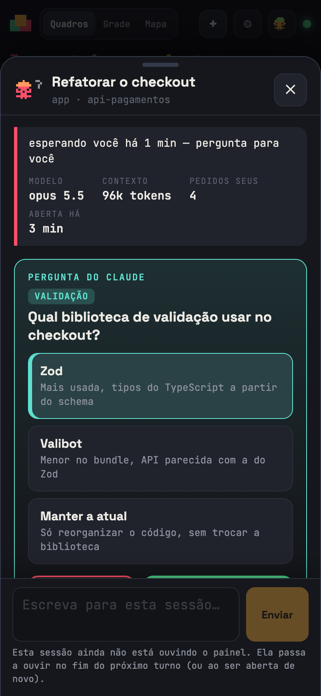
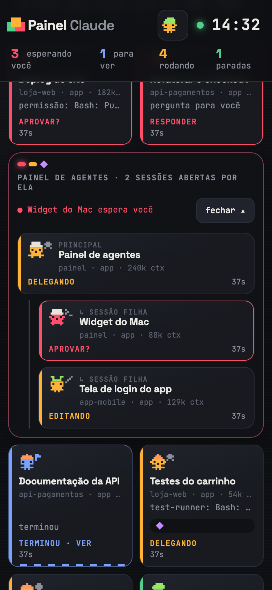
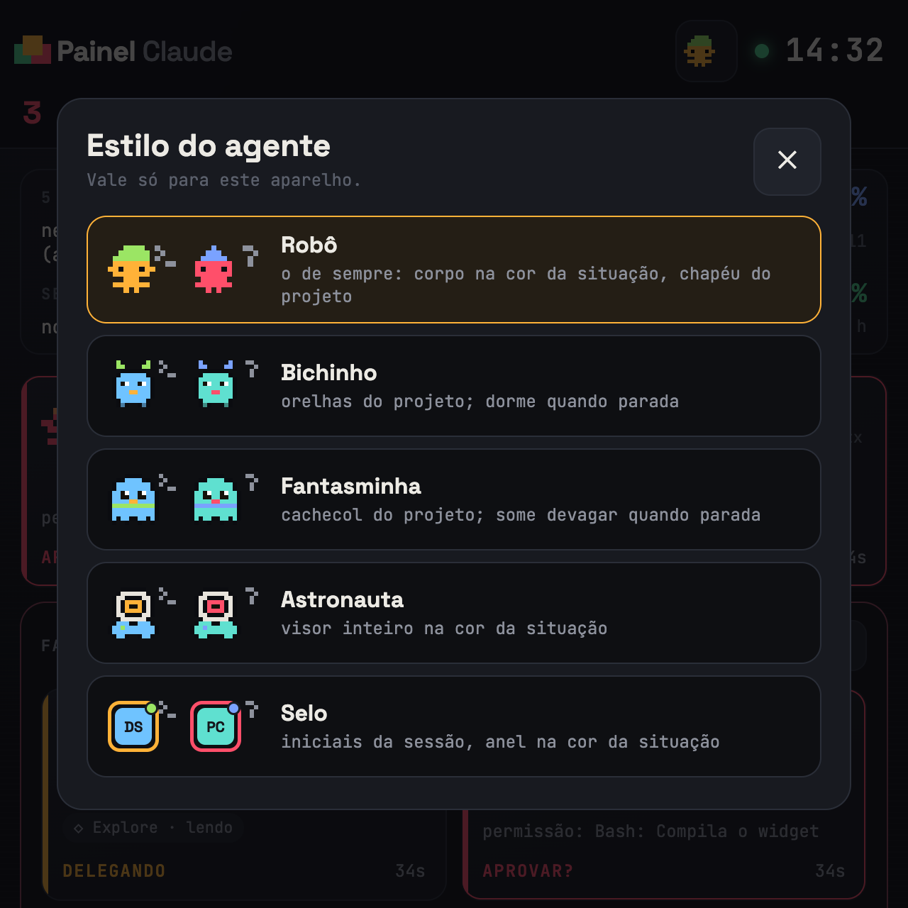
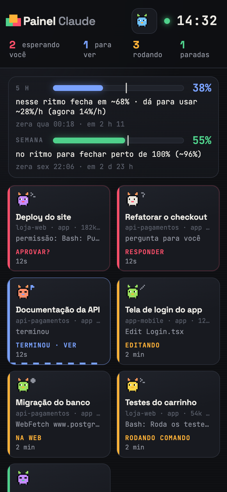

# Painel Claude

Um painel que mostra, em tempo real, todas as sessões do Claude Code abertas no seu Mac e deixa você agir nelas de
longe: do celular, do tablet, de outra aba do navegador ou de um widget na mesa do Mac.

Você vê quem está **rodando**, quem está **esperando você**, quem **terminou** e quem está **parado**. Quando o
Claude pede uma permissão, faz uma pergunta ou quer aprovar um plano, dá para responder pelo painel sem voltar ao
computador.

<p align="center">
  
</p>

<p align="center">
  
</p>

<table>
  <tr>
    <td align="center"><br><sub>Aprovar um comando pelo celular</sub></td>
    <td align="center"><br><sub>Responder uma pergunta do Claude</sub></td>
    <td align="center"><br><sub>Família aberta no lugar</sub></td>
  </tr>
</table>

> **Versão 0.2:** subagentes, famílias de sessões e uso semanal pelo app do Claude. Funciona só no **macOS** por
> enquanto (veja [Futuro](#futuro)). Baixe a última versão em [Releases](https://github.com/gflexdev/painel-claude/releases/latest).

## O que dá para fazer

**Monitorar**

- Ver todas as sessões numa grade, cada uma com um personagem. O corpo é da sessão, um detalhe tem a cor do
  projeto e a cor do tile é a situação.
- A ordem é por urgência: primeiro quem espera você, depois erro, depois "terminou · ver", depois rodando e,
  por último, parada.
- Saber o que cada uma está fazendo agora: lendo, editando, rodando comando, na web, delegando, planejando,
  perguntando ou pensando.
- Ver os contadores no topo: quantas esperam você, quantas terminaram e você ainda não viu, quantas estão rodando.
- **Subagentes:** quando uma sessão chama ajudantes (a ferramenta Agent), o quadrado ganha um losango ◇ por
  subagente, com o tipo e o que está fazendo. Se o pedido de permissão vier de um subagente, o painel diz qual.
- **Famílias:** uma sessão que abriu outras no app do Claude vira um quadrado com cartas atrás e uma barrinha
  colorida por sessão de dentro. Um selo vermelho avisa quando alguém de dentro espera você. Tocar no quadrado
  abre a família ali mesmo, com a sessão principal ligada às filhas.

**Acompanhar**

- Tocar numa sessão e ver o último pedido, a última resposta (com o markdown formatado) e as ferramentas usadas
  por último.
- Ver o tamanho do contexto em tokens, o modelo, quantos pedidos você fez e há quanto tempo ela está aberta.
- Ver no detalhe os subagentes (os ativos e os que já terminaram) e as sessões ligadas: quem abriu esta e quem
  ela abriu, cada uma com um toque para abrir.
- Acompanhar o **uso do plano** (limite de 5 h e da semana), com uma linha de ritmo: dá para usar mais, você está
  no ritmo ou vai acabar antes do reset.

**Decidir**

- **Permissões:** Permitir ou Negar um comando, uma edição ou o acesso a um site.
- **Perguntas do Claude:** escolher as opções (uma ou várias) ou escrever a resposta.
- **Planos:** Aprovar ou Recusar o plano, lendo-o por extenso.

Vale quem responder primeiro: painel, widget ou o diálogo no Mac. Se você responder no Mac, o pedido some do
painel.

**Extras**

- **Estilo do personagem:** Robô, Bichinho, Fantasminha, Astronauta ou Selo. Cada aparelho guarda o seu.

<table>
  <tr>
    <td align="center"><br><sub>Os cinco estilos de personagem</sub></td>
    <td align="center"><br><sub>A grade com o Bichinho</sub></td>
  </tr>
</table>

- **Widget do Mac** com os mesmos botões (opcional, precisa do Xcode).
- **Sessões de um servidor** (uma VPS, por exemplo) no mesmo painel, com o nome da máquina no tile (avançado).

## Antes de começar

| Precisa | Por quê |
|---|---|
| Um Mac com macOS (testado no macOS 26) | O painel roda como um serviço do macOS. |
| [Claude Code](https://claude.com/claude-code) instalado e aberto pelo menos uma vez | O painel lê os eventos dele. |
| [Node.js](https://nodejs.org) 20 ou mais novo | O servidor do painel é em Node. Se faltar, o instalador oferece instalar pelo Homebrew. |
| [Tailscale](https://tailscale.com) no Mac e no celular (opcional) | Abrir o painel no celular fora de casa e instalar como app. |
| Xcode e XcodeGen (opcional) | Só para o widget do Mac. |

## Instalar no Mac

1. Baixe a pasta do painel: o `.zip` que você recebeu ou um clone do repositório. Descompacte onde quiser, por
   exemplo em Downloads.
2. Abra o **Terminal**, entre na pasta e rode o instalador:

   ```bash
   cd ~/Downloads/painel-claude
   bash instalar.sh
   ```

3. Responda às perguntas que aparecerem:
   - **Instalar o Node.js?** Só aparece se ele faltar.
   - **Ligar o HTTPS pelo Tailscale?** Só aparece se o Tailscale estiver ligado. Diga sim se quiser usar no
     celular de qualquer lugar.
   - **Compilar o widget?** Só aparece se houver Xcode e XcodeGen.
4. No fim, o instalador mostra o **link com o seu token**, algo como `http://127.0.0.1:7777/?t=…`. Abra no
   navegador do Mac para conferir.
5. As sessões novas aparecem sozinhas. Sessões que já estavam abertas aparecem no próximo pedido que você fizer
   nelas. Se alguma não aparecer, feche e abra de novo.

### O que o instalador muda no seu Mac

- Copia o painel para `~/.local/share/painel-claude/app`. Depois disso, pode apagar a pasta baixada.
- Acrescenta os hooks do painel em `~/.claude/settings.json`, sem tirar os que você já tinha. Antes, guarda um
  backup ao lado (`settings.json.bak-painel-…`).
- Liga a status line do painel, que é por onde chega o uso do plano. Se você já tinha uma, ela continua
  aparecendo igual: a do painel só lê os dados e chama a sua.
- Cria um serviço que sobe junto com o Mac e se reinicia sozinho se cair. Não precisa deixar o Terminal aberto.
- Guarda o token, o estado e os logs em `~/.config/painel-claude/`.

Rodar o instalador de novo é seguro: nada se duplica, e o token continua o mesmo.

### Atualizar

Baixe a versão nova e rode `bash instalar.sh` de dentro dela. O token e as preferências continuam.

### Desinstalar

```bash
bash ~/.local/share/painel-claude/app/desinstalar.sh
```

Isso tira os hooks e o serviço e devolve a sua status line de antes. Com `--tudo` no fim, apaga também o app e os
dados (token e histórico).

## Abrir no celular ou no tablet

Há dois jeitos.

**Na mesma rede Wi-Fi do Mac (mais simples)**

1. No fim da instalação, o instalador lista links como `http://192.168.x.x:7777/?t=…` (rede local).
2. Abra esse link no navegador do celular. O token fica salvo no aparelho.
3. Funciona como página, mas só na mesma rede. Para instalar como app, use o jeito abaixo.

**De qualquer lugar, como app, pelo Tailscale (recomendado)**

O Tailscale cria uma rede privada entre os seus aparelhos. O painel continua visível só para você.

1. Crie uma conta grátis em [tailscale.com](https://tailscale.com) e instale o app no Mac e no celular, com a
   **mesma conta**.
2. No [painel de administração do Tailscale](https://login.tailscale.com/admin/dns), ative **MagicDNS** e
   **HTTPS Certificates**.
3. Rode `bash instalar.sh` de novo e responda **sim** em "Ligar o HTTPS pelo Tailscale?". Se preferir fazer à
   mão:

   ```bash
   tailscale serve --bg --https=443 http://127.0.0.1:7777
   ```

4. O instalador mostra o link `https://<nome-do-mac>.<sua-rede>.ts.net/?t=…`. Com o `qrencode` instalado
   (`brew install qrencode`), aparece também um QR code para apontar a câmera.
5. Abra o link no celular, com o Tailscale ligado, e instale como app (veja o [FAQ](#faq)).

## Usando o painel

- **Cores dos tiles:** âmbar = rodando, vermelho = esperando você, azul listrado = terminou e você ainda não viu,
  verde = parada, roxo = erro.
- **Tocar num tile:** abre o detalhe da sessão. Se ela estava em "terminou · ver", passa para vista.
- **Pedido pendente:** o detalhe mostra um cartão com o comando inteiro (ou a pergunta, ou o plano) e os
  botões. Depois de responder, o Claude segue na hora.
- **Barra de uso, no topo:** o risco branco marca onde você deveria estar agora para gastar 100% até o reset. A
  frase embaixo diz o que fazer: usar mais (azul), manter (verde) ou segurar (vermelho).
- **Família fechada:** o quadrado com cartas atrás. Cada barrinha embaixo é uma sessão de dentro, na cor da
  situação dela (a vermelha brilha), e o número no canto diz quantas esperam você.
- **Família aberta:** tocar no quadrado abre a família no lugar, ocupando a linha: a principal, a linha até as
  filhas ("↳ sessão filha") e as etiquetas dos subagentes. Tocar num quadrado de dentro abre o detalhe;
  "fechar ▴" volta ao quadrado. Só uma família fica aberta por vez.
- **◇ Subagentes:** losangos roxos na faixa do quadrado; dentro da família aberta, etiquetas com o que cada um faz.
- **Estilo do personagem:** o botão com o bonequinho, ao lado do relógio.
- **Mac fora do ar:** uma faixa vermelha no topo diz há quanto tempo o painel não tem notícia do Mac.

## Segurança

- **O link com `?t=…` é a chave do seu Mac.** Quem tiver o link pode aprovar comandos no seu computador. Não
  mande o seu link para ninguém, nem em print.
- Cada pessoa instala no próprio Mac e tem o próprio token, gerado na instalação.
- Nada sai do seu Mac. O painel não usa servidor externo, e o Tailscale só liga os seus aparelhos.
- Para trocar o token (se ele vazar): apague a linha `"token"` de `~/.config/painel-claude/config.json` e rode
  `bash instalar.sh` de novo. Ele gera outro, e os aparelhos vão pedir o link novo.

## FAQ

**Funciona no Windows ou no Linux?**
Ainda não. O painel depende de três coisas do macOS: o serviço que sobe com o Mac (launchd), os scripts de hook
em shell e o instalador. No Linux daria para adaptar com pouco trabalho (systemd no lugar do launchd). No Windows,
os hooks precisam ser reescritos. Os dois estão em [Futuro](#futuro). Enquanto isso, um servidor Linux já pode
**mandar as sessões dele** para o painel de um Mac (veja [Sessões de um servidor](#sessões-de-um-servidor-avançado)).

**Como fixo o painel na tela inicial do celular?**
Abra o link HTTPS do Tailscale e:

- **iPhone (Safari):** botão Compartilhar → **Adicionar à Tela de Início**.
- **Android (Chrome):** menu ⋮ → **Instalar app** ou **Adicionar à tela inicial**.

Ele abre em tela cheia, com ícone próprio, como um app. Pelo link `http://` da rede local, o celular cria só um
atalho para o navegador.

**E no Mac, dá para deixar como app no Dock?**
Sim. No Chrome, abra `http://127.0.0.1:7777/?t=…` e use o menu ⋮ → **Transmitir, salvar e compartilhar** →
**Instalar página como app**. No Safari: **Arquivo → Adicionar ao Dock**.

**Quero deixar um tablet velho só com o painel na mesa.**
Abra o link, instale como app e deixe o tablet na tomada. No Android, ative "Permanecer ativo" nas Opções do
desenvolvedor para a tela não apagar.

**Preciso deixar o Terminal aberto?**
Não. O painel roda como serviço, sobe sozinho quando o Mac liga e se reinicia se cair.

**Uso o Claude Code no app do Claude, no VS Code ou no terminal. Aparece tudo?**
Sim. Os hooks ficam no `~/.claude/settings.json`, que vale para todo lugar onde o Claude Code roda com o seu
usuário. O tile mostra de onde veio a sessão.

**De onde vem o uso do plano?**
De dois lugares, e vale o mais novo. As sessões de terminal mandam o uso pela status line, com o dia e a hora do
reset. O app do Claude guarda o % da semana num arquivo próprio, e o painel lê esse arquivo a cada 20 s. O app não
guarda o horário do reset, então o painel usa o último que aprendeu pela status line. Se nunca abriu uma sessão de
terminal, a barra mostra só o %, sem o ritmo; abrir `claude` no terminal uma vez resolve.

**Por que algumas sessões não aparecem como família?**
O vínculo de "sessão filha" vem do app do Claude no Mac. Sessões abertas no terminal ou na VPS não guardam quem as
abriu, então aparecem soltas. Se a sessão mãe já saiu do painel, a filha aparece solta com "↳ sessão filha".

**Uma sessão não aparece.**
As sessões que já estavam abertas antes da instalação aparecem no próximo pedido que você fizer nelas. Se não
aparecer, feche e abra a sessão.

**Uma sessão fechada continua "rodando".**
Às vezes o Claude fecha sem avisar. Depois de 15 min sem notícia, o tile mostra "sem sinal há …", e a sessão sai
sozinha do painel mais tarde.

**Respondi no Mac e no celular ao mesmo tempo. Qual vale?**
O primeiro que chegar. O outro é ignorado, e o painel avisa que o pedido já foi respondido.

**O Mac dormiu. O Claude trava?**
Não. Os hooks desistem em 1 s se o painel não responder, e o Claude segue normal. O celular mostra "Sem conexão
com o Mac" até ele acordar.

**O macOS perguntou se o "node" pode aceitar conexões.**
Responda **Permitir** se quiser abrir o painel pela rede Wi-Fi. Pelo Tailscale com HTTPS, não precisa.

**Tenho dois Macs.**
Instale nos dois. Cada um tem o próprio painel e o próprio token.

**Onde ficam os logs, se algo der errado?**
Em `~/.config/painel-claude/servidor.log`. Para reiniciar o serviço:

```bash
launchctl kickstart -k gui/$(id -u)/br.com.gflex.painel-claude
```

## Widget do Mac (opcional)

Um widget para a mesa e para a Central de Notificações, com as sessões e os botões Permitir, Negar e responder.
Precisa de macOS 14, Xcode 15 e XcodeGen (`brew install xcodegen`). O instalador oferece compilar. Se preferir
compilar à mão, rode `bash widget-mac/instalar.sh` e depois adicione pela galeria: clique direito na mesa →
**Editar Widgets** → **Painel Claude**. Detalhes em [widget-mac/README.md](widget-mac/README.md).

## Sessões de um servidor (avançado)

Se você roda o Claude Code numa VPS ou noutra máquina Linux, as sessões de lá podem aparecer no painel do Mac,
com o nome da máquina no tile e aprovação pelo painel. Precisa do Tailscale nas duas máquinas e de acesso SSH do
Mac ao servidor:

```bash
cd ~/.local/share/painel-claude/app
npm run install-vps -- <alias-ssh> --nome <nome-da-maquina>
```

Como funciona e as regras de segurança: [docs/tecnico.md](docs/tecnico.md#sessões-de-outra-máquina-vps).

## Futuro

- **Em breve: painel de bancada.** Uma tela touch de 4" com ESP32 (Guition ESP32-4848S040), ligada na tomada e no
  Wi-Fi, ao lado do computador, mostrando as sessões e com os mesmos botões. O firmware já roda no simulador e
  está em [firmware/](firmware/README.md); falta testar na placa e desenhar a caixa impressa em 3D.
- **Linux:** instalador com systemd no lugar do launchd.
- **Windows:** hooks em PowerShell e instalador próprio.
- **Estilos de personagem também no widget e no ESP32.**
- **Subagentes e famílias também no widget e no ESP32.**

## Licença

[PolyForm Noncommercial 1.0.0](LICENSE.md). Em resumo:

- **Pode:** usar, estudar, modificar e compartilhar, para uso pessoal, estudo, pesquisa, hobby e em
  organizações sem fins lucrativos (escolas, ONGs, órgãos públicos).
- **Não pode:** vender, oferecer como produto ou serviço pago, nem usar com fim comercial.
- **Ao compartilhar:** mande junto o arquivo de licença e a linha `Required Notice` do fim dele.

O resumo acima é só um guia; o que vale é o texto da licença. Para uso comercial, fale com o autor.

## Para quem quer mexer no código

API, hooks, segurança e desenvolvimento: [docs/tecnico.md](docs/tecnico.md). Testes: `npm test`.

As imagens deste README são de um painel de demonstração com sessões de exemplo, geradas por
`scripts/capturas.mjs`. Nenhuma sessão real aparece nelas.
